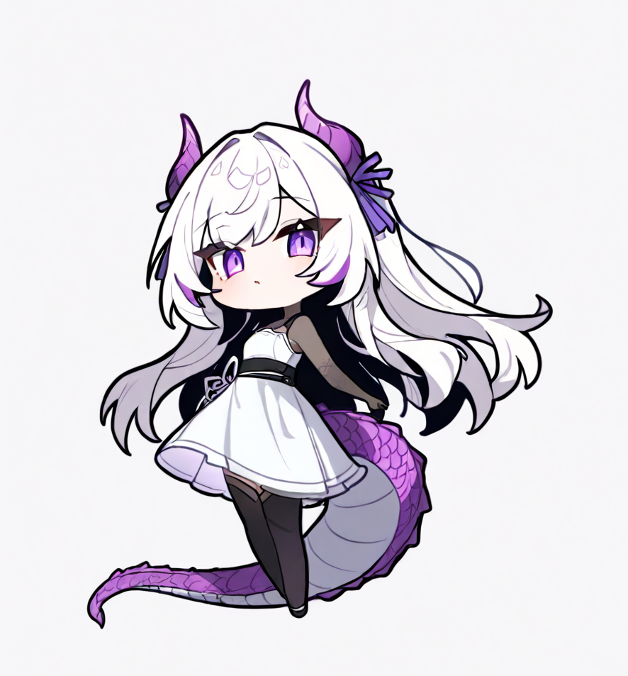

### [⬇ 下载 Windows 安装包 · GitHub Releases v0.1.9](https://github.com/213uuu/baishuang.pet/releases/tag/v0.1.9)
### [AtomGit 镜像仓库 / Release](https://atomgit.com/u213uuu/baishuang.pet)

# 白霜 · Baishuang

一个面向 Windows 的独立桌面宠物：透明置顶窗口、逐帧动画、云朵气泡、Codex / DeepSeek Harness 工作状态检测，以及 DeepSeek 余额查询。




## 功能

- 透明置顶桌宠窗口，支持拖动、点击、连续点击和右键菜单。
- 多个逐帧动作状态与云朵气泡，气泡会根据实际轮廓重新换行和缩放。
- 动画中的暗绿噪点会压成暗灰，角色轮廓一周的绿色偏色也会逐像素清除。
- 启动、余额刷新和周期置顶不会抢走当前应用的前台焦点。
- 通过 Codex 实时日志与会话文件检测工作状态。
- 通过 `DSH_HOME` 会话文件检测 DeepSeek Harness 工作状态。
- Codex 与 DSH 同时工作时，播放“多次点击反应 A → 进入工作 → 稳定保持”路径。
- 休闲动画播放期间检测到工作开始时，会等当前动画播完再进入工作。
- 右键查询 DeepSeek API 余额；密钥只在运行时从本机 Codex 配置读取。
- 附带可选的 Windows 托盘入口、启动动画和开机启动脚本。

## 环境

- Windows 10 / 11
- Python 3.10 或更新版本
- 运行桌宠本身不需要安装第三方 Python 包
- 重新生成帧或气泡预览时需要 Pillow；绿幕残留处理还需要 NumPy

## 快速开始

1. 下载或克隆本仓库。
2. 在**文件资源管理器**中双击 `start-pet.cmd`。
3. 右键白霜可以说话、查余额或退出。

如果 `pythonw.exe` 不在 `PATH` 中：

```powershell
$env:BAISHUANG_PYTHONW = "C:\Path\To\pythonw.exe"
.\start-pet.cmd
```

也可以使用托盘入口：

```powershell
pythonw.exe pet-tray.py
```

### 不要从受限沙箱启动

从 Codex 或其他禁止联网的沙箱进程启动白霜时，窗口仍可显示，但余额查询会失败并提示：

> 余额查询失败：当前白霜运行环境禁止联网。请关闭后双击 start-pet.cmd 重新打开。

日常使用时请从资源管理器双击启动。

## 操作

| 操作 | 效果 |
| --- | --- |
| 单击 | 对话或工作互动 |
| 快速连续点击 | 多次点击反应 |
| 拖动 | 移动窗口 |
| 右键 | 说句话 / 查余额 / 看动画 / 模式选择 / 退出 |
| `Ctrl+Alt+B` | 托盘模式下打开白霜 |
| `Ctrl+Alt+Shift+B` | 托盘模式下关闭白霜 |

## 工作状态检测

Codex：

- 实时读取 `~/.codex/logs_2.sqlite` 中的回合事件。
- 同时保留 `~/.codex/sessions/**/*.jsonl` 作为回退。
- 30 秒内有回合活动视为工作中，75 秒无活动视为收工。

DSH：

- 优先使用 `DSH_HOME`，默认目录为 `~/.dsh`。
- 读取 `sessions/**/session*.jsonl*` 的最近写入时间。
- 12 秒内有写入视为开始工作，35 秒无写入视为收工。

## 目录结构

```text
desktop_pet.py         主程序与状态机
bubble_shape.py        云朵气泡几何和配色
pet-tray.py            Windows 托盘入口
pet-control.ps1        打开 / 关闭 / 重启 / 状态查询
frames/                当前运行帧
startup-animation/     启动动画帧
fonts/                 随应用分发的悠哉字体
assets/                图标
tools/                 素材预处理工具
tests/                 无窗口单元测试
docs/                  架构、素材与 GitHub 发布说明
```

## 开发与测试

```powershell
python -m unittest discover -s tests -v
python -m py_compile desktop_pet.py bubble_shape.py pet-tray.py
```

重新生成开发工具所需环境：

```powershell
python -m pip install -r requirements-dev.txt
```

更多说明见：

- [架构](docs/ARCHITECTURE.md)
- [素材与重建流程](docs/ASSETS.md)
- [GitHub 发布检查](docs/PUBLISHING_GITHUB.md)

## 隐私与凭证

仓库不包含 API Key、`auth.json`、运行日志、PID 文件、个人快捷方式或旧素材备份。

余额功能只在内存中读取本机 Codex 配置，不会把密钥写入仓库或日志。

## 仓库体积

当前完整运行资产约 330 MB，主要是 PNG 逐帧动画和字体文件。所有单文件都低于 GitHub 的 100 MB 限制，因此不要求 Git LFS。

## 许可证

- 源代码：MIT，见 [LICENSE](LICENSE)。
- 原创角色美术、动画帧和启动动画：CC BY 4.0，见 [ASSET_LICENSE.md](ASSET_LICENSE.md)。
- 悠哉字体：SIL Open Font License 1.1，见 [THIRD_PARTY_NOTICES.md](THIRD_PARTY_NOTICES.md)。

如果你不希望美术资产允许商业复用，请在发布前把 `ASSET_LICENSE.md` 改为更严格的许可证。
