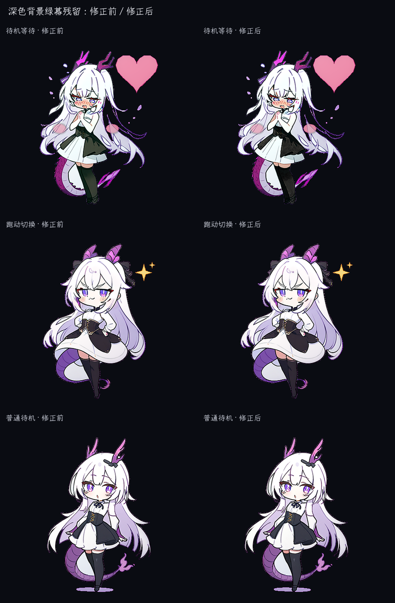
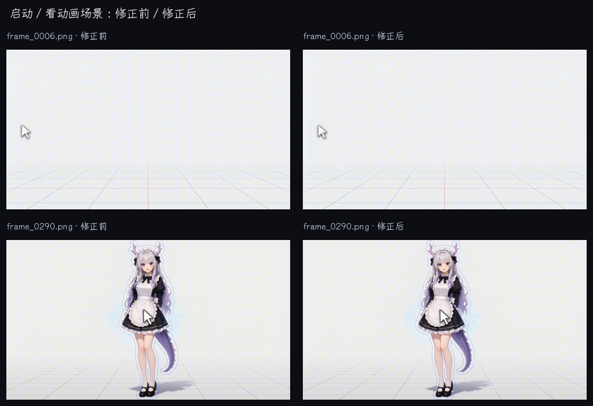
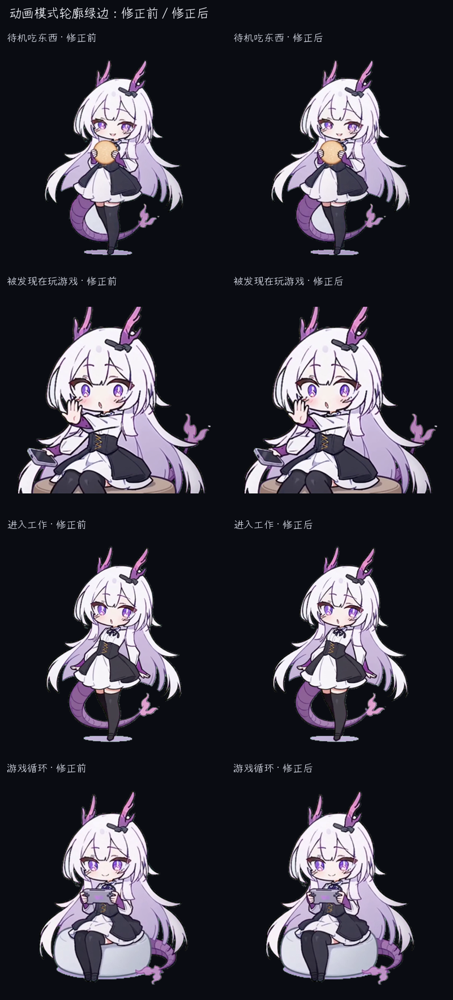

# Green Residue Suppression Report

Date: 2026-10-24

## Goal

Remove both contour spill and the darker green screen noise that becomes visible
when a sprite is composited over a dark desktop.

## Method

- Detect sprite pixels using alpha or the exact chroma background.
- Leave exact `#00ff00` and fully transparent pixels unchanged.
- For dark pixels with material green bias, cap the green contribution and
  convert the pixel to a darker neutral gray.
- For bright highlights with green bias, keep brightness and only neutralize
  the green cast.
- Keep the original alpha channel and avoid changing non-green sprite colors.

## Results

- Processed runtime frames: 1,421
- Processed startup / animation-view scene frames: 488
- Changed runtime pixels: 629,506
- Animation-mode silhouette pixels with green bias: 162,062 before, 0 after
- Green-biased pixels were processed across every runtime animation group.
- Strong green bias (`G - max(R, B) >= 12`) was eliminated in the full audit.
- The maximum residual green bias is `7`, confined to near-white neutralized highlights.
- Startup scene cleanup changed 488 green-cast pixels without altering scene geometry.
- Exact chroma-key backgrounds, alpha shapes, and all non-target pixels were
  preserved byte-for-byte.
- Before/after visual comparison:

The comparison verifies that hair highlights, clothing colors, outlines, and
transparent silhouettes remain intact.

Startup / “watch animation” scene comparison:

Animation-mode silhouette comparison:

## Runtime transparency-key fix

Capturing the real Tk window showed that the remaining circle was produced at
render time, not stored in the PNG frames. Semi-transparent sprite edges were
being blended against the bright-green window key.

- Before: 512 bright green rendered pixels around the visible silhouette.
- After changing the runtime key to `#110703`: 0 bright green rendered pixels.
- Captured-window comparison:

## Tool

`tools/suppress_green_residue.py`
