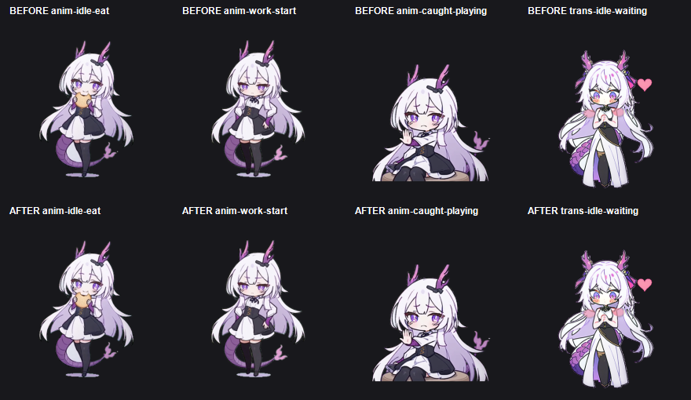

# Green Edge Despill Report

Date: 2026-10-22

## Goal

Reduce low-level green spill that becomes visible when the transparent sprite is
composited over a dark desktop.

## Method

- Detect sprite pixels using alpha or the exact chroma background.
- Inspect four-neighbour contour edges.
- If `G > max(R, B) + 2`, clamp the edge pixel to `G = max(R, B)`.
- Leave sprite interiors, alpha values, and exact `#00ff00` backgrounds unchanged.

## Results

- Processed runtime frames: 1,421
- Animation edge spill above threshold: eliminated in sampled frames.
- Strong edge spill (`>10`): zero in sampled frames.
- Before/after visual comparison:

The comparison verifies that hair highlights, clothing colors, outlines, and
transparent silhouettes remain intact.

## Tool

`tools/despill_animation_edges.ps1`
